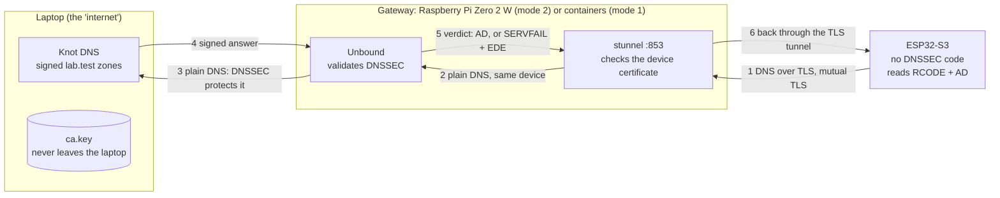

# Authenticated Gateway-Assisted DNSSEC for IoT Clients

**Team Astro · A3-PS004-TC136 · AIORI-3 · Problem statement PS-004**

An ESP32 cannot afford to validate DNSSEC (one lookup is 20+ queries and many signature checks).
So a **gateway** validates for it, and the ESP32 trusts the gateway's verdict **only** because the
reply comes over an **authenticated, encrypted channel** (DNS-over-TLS with mutual TLS).
The device then acts on three things it can read cheaply: `RCODE`, the `AD` flag and (for the log) the extended error.

> **Honest scope:** this is *not* end-to-end DNSSEC. The device trusts its gateway. DNSSEC protects
> internet → gateway, mutual TLS protects gateway → device. You need both. See [Limits](#limits).

---

## Architecture



| Hop | Protected by |
|---|---|
| ESP32 ↔ stunnel | **mutual TLS**: the device checks the gateway cert, the gateway checks the device cert (both signed by our own CA) |
| stunnel → Unbound | same device, never on the wire (Unbound listens on `127.0.0.1` on the Pi) |
| Unbound ↔ Knot | **DNSSEC**: a forged answer can only cause a failure, never a wrong answer |

Two run modes share the same configs and the same firmware code:

| Mode | Where things run |
|---|---|
| **1: lab** | Knot, Unbound and stunnel as containers on one laptop ([Containerlab](https://containerlab.dev), Docker) |
| **2: hardware** | Knot on the laptop, **Unbound + stunnel natively on a Raspberry Pi Zero 2 W**, the ESP32 as the client |

## What the device decides

| Gateway reply | Device verdict | Action |
|---|---|---|
| `NOERROR` + `AD` | SECURE | use the IP |
| `NOERROR`, no `AD` | INSECURE | use it **unless** the name is on the *must-be-secure* list (e.g. firmware-update hosts), then refuse |
| `SERVFAIL` | BOGUS | refuse |
| no gateway, TLS error, untrusted certificate | no answer | **refuse. Never fall back to plain DNS** |

The device decides on RCODE + AD only: resolvers pick different EDE numbers for the same failure (see `results/04`), so EDE is only logged.

## Verified results

Every claim below points to a file in [`results/`](results/) holding the raw output and the conditions.

| Claim | Evidence |
|---|---|
| The gateway validates: signed → `AD`, unsigned → no `AD`, expired / future / bad signature → `SERVFAIL` (EDE 7 / 8 / 6) | [01](results/01-zones-via-dot.txt), [12](results/12-unbound-reasons.txt) |
| A signed zone whose parent publishes a DS with an **unknown algorithm** looks *unsigned* (silent downgrade). Control: the same DS with algorithm 8 gives `AD` | [02](results/02-unknownalg-downgrade.txt) |
| Missing signatures → `SERVFAIL`, EDE 10. DS for a key that is not in the zone → `SERVFAIL`, EDE 6 | [03](results/03-nosig-missing-rrsigs.txt), [04](results/04-nokey-ds-without-key.txt) |
| Only devices with a certificate from our CA get answers; no certificate is refused before any DNS | [05](results/05-dot-mtls-ok.txt), [06](results/06-dot-no-cert.txt) |
| A client certificate from a **fake CA with the same name** is refused | [08](results/08-fake-ca-rejected.txt) |
| The gateway's own cert cannot be used as a client cert (certificate purpose) | [13](results/13-gateway-cert-as-client.txt) |
| **The ESP32 refuses a rogue gateway** (same name, fake CA): `mbedtls -0x2700`, no query sent | [15](results/15-rogue-gateway.txt) |
| **Fail closed**: gateway stopped → the ESP32 refuses, no fallback | [09](results/09-gateway-down-fail-closed.txt) |
| Unbound cannot be reached except through stunnel (two locks) | [10](results/10-back-door.txt) |
| A client cannot switch validation off with the CD bit (`ignore-cd-flag`) | [11](results/11-cd-flag.txt) |
| **End to end on real hardware** (ESP32 → Pi → laptop), all nine names. The silent downgrade is refused by the device's must-be-secure list | [14](results/14-esp32-via-pi-verdicts.txt), [16](results/16-esp32-all-zones-via-pi.txt) (first run: [07](results/07-esp32-dot-verdicts.txt)) |

Measured: mutual-TLS handshake about **1.7 to 2.1 s** on the ESP32 (once per connection); query **10 to 20 ms** with a warm gateway cache, **69 to 493 ms** cold; firmware **849 KB** flash, **38 KB** static RAM.

## Limits

| Limit | Detail |
|---|---|
| Not end-to-end | a compromised gateway can lie. The device protects itself only against the network, not against its gateway |
| Certificate dates are **not checked** on the ESP32 | no clock (SNTP planned), so an expired gateway cert would still be accepted |
| No revocation | a stolen device cert works until it expires (CRL or a device allow-list is the planned fix) |
| Trust in "anything our CA signs" | a leaked `ca.key` allows a fake gateway; pinning the gateway key is planned |
| The gateway IP is compiled into the firmware | it avoids DHCP/DNS redirection, but a changed network means a rebuild |
| A rogue gateway causes denial of service, not forged answers | the device goes offline (fail closed) |
| The Pi has no battery clock | validation depends on the Pi's time being right after boot |
| Benchmarks | warm/cold numbers above are single runs. A 50-100 run benchmark, a plain-UDP baseline and an on-device crypto cost estimate are **planned, not done** |

## Repository layout

| Path | What |
|---|---|
| `gateway/knot/` | Knot config and the nine `lab.test` zones (signed by Knot, or hand-signed `*.zone.signed`) |
| `gateway/unbound/`, `gateway/stunnel/` | the gateway configs and their Containerfiles (mode 1) |
| `gateway/pki/` | certificates and `.ext` files. **Private keys are not in the repo** |
| `gateway/handsigned/` | where the keys of the hand-signed zones live (git-ignored) |
| `pi/` | the Unbound and stunnel configs that differ on the Pi (mode 2) |
| `lab/dnssec.clab.yml` | the Containerlab topology (mode 1) |
| `client/esp32-1/` | the ESP32 firmware (ESP-IDF via PlatformIO) |
| `attacks/rogue-gateway/` | the fake-gateway stunnel config |
| `tests/make-fakeca.sh` | builds an attacker's fake CA (outside the repo) |
| `results/` | the evidence: raw outputs with their conditions |

## Run it

You need your own PKI: the committed `.crt` files belong to the authors' CA and their keys are not published.

**Tools used:** Docker 29, Containerlab 0.82, Knot 3.6.2, Unbound 1.25.2 (Pi: 1.26.2), stunnel 5.76 (Pi: 5.74), OpenSSL 3.5, PlatformIO 6.1 with ESP-IDF (ESP32-S3).

### Mode 1: everything in containers

```bash
# 1. PKI (P-256)
cd gateway/pki
openssl genpkey -algorithm ec -pkeyopt ec_paramgen_curve:prime256v1 -out ca.key
openssl req -new -x509 -key ca.key -days 360 -subj "/CN=LAB CA" \
  -addext "basicConstraints=critical,CA:TRUE" -addext "keyUsage=critical,keyCertSign,cRLSign" -out ca.crt
for n in gateway esp32-1; do
  openssl genpkey -algorithm ec -pkeyopt ec_paramgen_curve:prime256v1 -out $n.key
  openssl req -new -key $n.key -subj "/CN=$n" -out $n.csr
  openssl x509 -req -in $n.csr -CA ca.crt -CAkey ca.key -days 360 -extfile $n.ext -out $n.crt && rm $n.csr
done
cd ../..

# 2. the two small images
docker build -t lab-unbound -f gateway/unbound/Containerfile gateway/unbound
docker build -t lab-stunnel -f gateway/stunnel/Containerfile gateway/stunnel

# 3. start the lab (Knot generates new DNSSEC keys on first start)
cd lab && containerlab deploy && cd ..
```

Knot's new keys mean two new DS values (the hand-signed zones ship pre-signed and need nothing):

```bash
docker exec clab-dnssec-knot keymgr lab.test. list           # note the KSK tag (flag 257)
docker exec clab-dnssec-knot keymgr lab.test. ds <tag>       # digest-2 line -> trust-anchor in gateway/unbound/unbound.conf
docker exec clab-dnssec-knot keymgr signed.lab.test. list
docker exec clab-dnssec-knot keymgr signed.lab.test. ds <tag>  # -> the signed.lab.test. DS line in gateway/knot/lab.test.zone
docker exec clab-dnssec-knot knotc zone-reload lab.test.
docker exec clab-dnssec-knot knotc zone-ksk-submitted lab.test.
docker exec clab-dnssec-knot knotc zone-ksk-submitted signed.lab.test.
docker restart clab-dnssec-unbound
```

Ask through the gateway as the device would (`ad` flag expected):

```bash
kdig @127.0.0.1 -p 8530 +tls +tls-ca=gateway/pki/ca.crt +tls-hostname=gateway.lab.test \
  +tls-certfile=gateway/pki/esp32-1.crt +tls-keyfile=gateway/pki/esp32-1.key A ota.lab.test
```

The nine names: `ota.lab.test`, `ota.signed`, `ota.unsigned`, `ota.expired`, `ota.future`, `ota.badsig`, `ota.unknownalg`, `ota.nosig`, `ota.nokey` (all under `.lab.test`).
Expected results are in `results/01` to `04`. Restart Unbound between tests: it caches.

### Mode 2: Raspberry Pi gateway

```bash
cd lab && containerlab deploy --node-filter knot     # laptop: Knot only, published on :5300
```

On the Pi (Debian): `apt install unbound stunnel4 knot-dnsutils`; copy **only** `ca.crt`, `gateway.crt` and `gateway.key` to
`/etc/stunnel/` (owner root, key mode 600, **never `ca.key`**); use `pi/stunnel/dot.conf` and `pi/unbound/lab.conf`
(set `stub-addr` to `<laptop-ip>@5300` and the trust anchor); then `systemctl enable --now stunnel@dot`
(keep `stunnel4.service` disabled: both would claim port 853).

### The ESP32

```bash
cd client/esp32-1
cp src/secrets.example.h src/secrets.h                 # Wi-Fi name and password (git-ignored)
cp ../../gateway/pki/{ca.crt,esp32-1.crt,esp32-1.key} certs/
# set the gateway address of each env in platformio.ini
pio run -e pi  -t upload      # mode 2: the Pi on :853
pio run -e lab -t upload      # mode 1: the laptop's stunnel on :8530
pio device monitor
```

### Attack tests

| Test | How | Expected |
|---|---|---|
| no client certificate | the kdig command above without `+tls-certfile/keyfile` | TLS alert, nothing reaches Unbound (`results/06`) |
| fake CA | `tests/make-fakeca.sh ~/fakeca`, then kdig with `fake-esp32-1.*` | refused (`results/08`) |
| rogue gateway | run `attacks/rogue-gateway/rogue-stunnel.conf` with the fake gateway cert on port 8531, then `pio run -e rogue -t upload` | `mbedtls -0x2700`, `no gateway, stopping` (`results/15`) |
| CD bit | kdig with `+cd` on `ota.badsig.lab.test` | `SERVFAIL`, same as without it (`results/11`) |
| gateway down | stop stunnel, reset the ESP32 | refuses, no fallback (`results/09`) |

## Keys

| Key | Held by | Never |
|---|---|---|
| `ca.key` | the laptop only | on the gateway or the ESP32 |
| `gateway.key` | the gateway | in git |
| `esp32-1.key` | the device (and its build) | in git |
| Knot's DNSSEC keys | a Docker volume on the laptop | in git (the DS values are public and are in git) |
