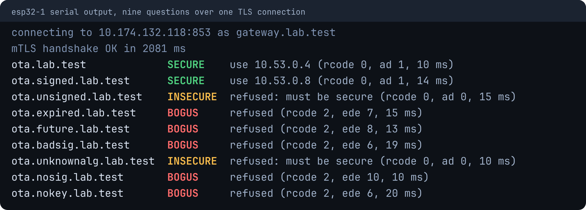
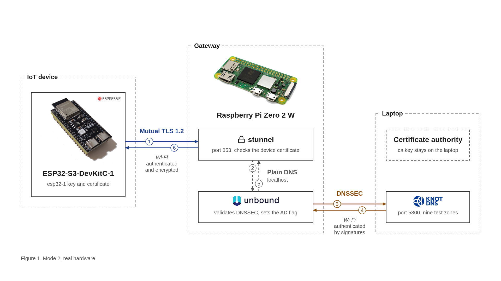
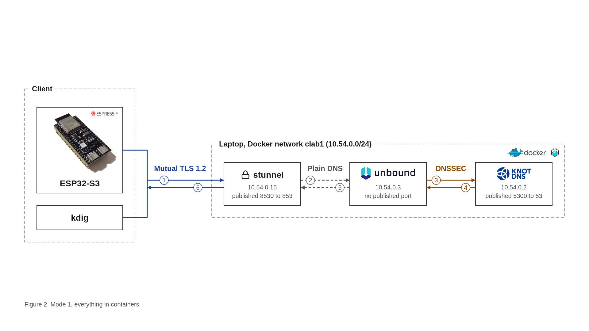
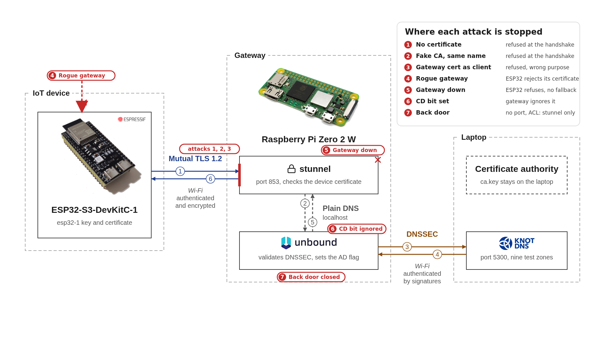

# Authenticated Gateway-Assisted DNSSEC for IoT Clients

Team Astro · A3-PS004-TC136 · AIORI-3, PS-004

Your smart bulb will believe anything. Plain DNS comes with no proof, and a bulb comes with no suspicion.

DNSSEC fixes that, but checking signatures is too much work for a tiny chip. So a Raspberry Pi does the checking and tells the ESP32 one bit: `AD`, "I checked, it's fine". The ESP32 only believes that bit over mutual TLS. No papers, no conversation.

It's gateway-assisted, not end-to-end: the ESP32 trusts its gateway.

## Watch it say no

Real output from the ESP32. Two good answers, seven refusals.



| `ota.*.lab.test` | What's going on | Device |
|---|---|---|
| `ota.lab.test`, `signed` | Perfectly fine | uses it |
| `unsigned` | Never signed anything | refuses |
| `expired` | The milk went off on 2 October | refuses |
| `future` | Dated next year, nice try | refuses |
| `badsig` | Forged handwriting | refuses |
| `nosig` | Claims to be signed, shows no signatures | refuses |
| `nokey` | Points to a key that doesn't exist | refuses |
| `unknownalg` | Signed in a language nobody speaks | refuses |

`unknownalg` is the sneaky one. The gateway sees nothing wrong, so only the ESP32's own must-be-secure list catches it.

## Architecture



Same thing as containers, so you can check my work without buying a Pi:



## Seven ways I tried to break it



All seven failed. The receipts are in [`results/`](results/).

## Numbers

| | |
|---|---|
| Mutual TLS handshake | about 1.7 s, once per connection |
| Query, warm cache | median 12.7 ms, p95 38 ms |
| Query, cold cache | 69 to 493 ms |
| 450 queries | 0 errors, free heap flat at 260 KB |
| Firmware | 849 KB flash, 38 KB RAM |

## Run it

```bash
tests/setup-lab.sh --dry-run   # see what it will do
tests/setup-lab.sh             # build the lab
tests/e2e.sh --mode lab        # 15 checks
```

The Pi and the ESP32 are in [`docs/setup.md`](docs/setup.md). The long explanation is in [`docs/how-it-works.md`](docs/how-it-works.md).

Built with [Knot DNS](https://www.knot-dns.cz/), [Unbound](https://nlnetlabs.nl/projects/unbound/), [stunnel](https://www.stunnel.org/), [Containerlab](https://containerlab.dev) and [ESP-IDF](https://github.com/espressif/esp-idf).
