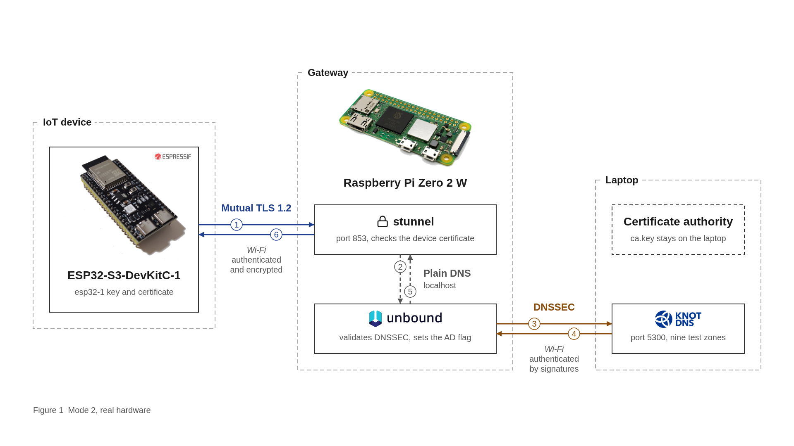
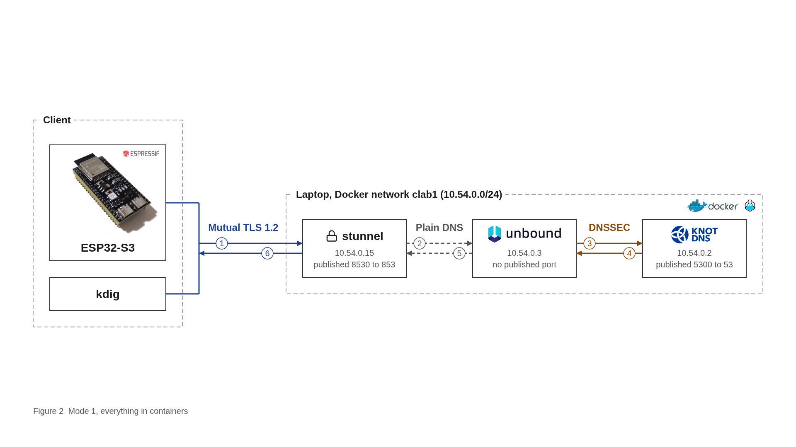
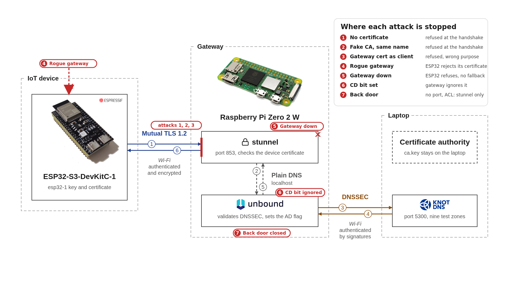

# How it works

The long version. The [README](../README.md) is the short one, and [`setup.md`](setup.md) has the commands.

## 1. The problem

DNS turns a name into an address, and plain DNS gives no proof that the answer is genuine. For a device that fetches firmware updates, a forged answer means downloading from the attacker.

DNSSEC adds signatures. A validating resolver follows the chain of trust from a key it already trusts, down through DS and DNSKEY records, and checks the RRSIG on each answer. That work is the problem for a small device: a single lookup can take 20 or more queries and several signature checks, plus code and memory for all of it.

The goal here is to give an ESP32 the benefit of DNSSEC without the cost, and without the device blindly trusting whatever is on the network.

## 2. The design

A gateway validates. The device does not. The device receives two things it can read cheaply, the response code and the `AD` (authenticated data) flag, and decides from those.

An `AD` flag is only a bit in a header, so anything on the path could set it. The design therefore depends on the channel: the flag only means something if it arrives over a connection where the device has proved who the gateway is. That connection is DNS over TLS with mutual authentication.

Each link has its own protection:

| Link | Protected by | Why that's enough |
|---|---|---|
| ESP32 ↔ stunnel | Mutual TLS 1.2 | Both sides check a certificate from our CA, so nobody else can read or change the traffic |
| stunnel → Unbound | Being the same machine | It never reaches the network |
| Unbound ↔ Knot | DNSSEC | The traffic is plain, but a change breaks a signature and produces a failure, not a wrong answer |

This is gateway-assisted, not end-to-end. The device trusts the gateway's verdict because it knows it's talking to the real gateway. Section 11 covers what that means.

## 3. The parts

| Part | Job | Why this one |
|---|---|---|
| ESP32-S3 | The client. Asks, reads `RCODE` and `AD`, applies its policy | A realistic constrained device |
| stunnel | Terminates TLS on port 853 and requires a client certificate | Unbound can serve TLS but can't demand a client certificate |
| Unbound | Validating resolver | Widely used, and reports Extended DNS Errors |
| Knot DNS | Authoritative server for `lab.test`, plays the internet | Automatic signing for the good zones, and can serve hand-made broken zones untouched |
| Own CA | Issues the gateway and device certificates | A closed system has no need for a public CA, and we control who is trusted |

There are two ways to run it, with the same logic.

**Mode 2, hardware.** Knot runs on the laptop in Docker. stunnel and Unbound run natively on a Raspberry Pi Zero 2 W with 415 MB of RAM. Unbound listens on `127.0.0.1` only.

**Mode 1, containers.** All three run under Containerlab on one laptop, on the network `10.54.0.0/24`. Only stunnel's TLS port and Knot's DNS port are published to the host.

I built mode 1 first to get the logic right, then moved to mode 2 to prove it on real hardware. Mode 1 stays useful because anyone can reproduce it with Docker.

## 4. One query, step by step

1. The ESP32 opens a TCP connection to port 853 on the gateway. The address is compiled in.
2. TLS handshake. The ESP32 checks that the gateway's certificate chains to `LAB CA` and names `gateway.lab.test`. stunnel asks for a client certificate and checks that it chains to the same CA. The result is TLS 1.2 with `ECDHE-ECDSA-AES256-GCM-SHA384`. This takes about 1.7 seconds on the ESP32 and happens once.
3. The ESP32 sends the query, with a random ID, the `AD` bit set to ask for validation status, and an EDNS record so the gateway can return extended errors. It doesn't set `DO`, because it doesn't want the signatures.
4. stunnel passes the plain DNS to Unbound.
5. Unbound walks the chain from its trust anchor for `lab.test`: DNSKEY, then the child's DS, then the child's DNSKEY, then the RRSIG on the answer. On a cache hit this step is skipped.
6. Unbound answers. Valid gives `NOERROR` with `AD`. Provably unsigned gives `NOERROR` without `AD`. Failed validation gives `SERVFAIL` with an Extended DNS Error.
7. The answer returns through the tunnel, and the ESP32 applies its policy.

All questions share one connection, so the handshake cost is paid once.

## 5. The firmware

| File | Job |
|---|---|
| `main.c` | Wi-Fi, connect, ask the nine names, print the verdicts |
| `dot.c` | The TLS connection through ESP-TLS, and sending and receiving DNS messages |
| `dns.c` | Builds a query, parses a reply, turns it into a verdict |
| `policy.c` | The must-be-secure list and the accept or refuse decision |
| `wifi.c` | Joins the network |
| `bench.c` | Benchmark mode (only in the `bench-*` builds) |

There's no DNSSEC code on the device. The parser reads the header, skips the records it doesn't need, and takes the first A record and any EDE code. Every offset is bounds-checked before it's used, and a malformed reply is a failure. Replies are small because no signatures are requested: the largest seen was 221 bytes, and anything over 512 is treated as a failure.

The decision:

| Gateway reply | Verdict | Action |
|---|---|---|
| `NOERROR` with `AD` | SECURE | Use the address |
| `NOERROR` without `AD` | INSECURE | Use it, unless the name is on the must-be-secure list |
| `SERVFAIL` | BOGUS | Refuse |
| Anything else, or no address | NO ANSWER | Refuse |
| No gateway, TLS error, bad certificate | none | Stop. Never fall back to plain DNS |

The must-be-secure list exists because "unsigned" is a normal state on the internet, so a resolver can't treat it as an error. Only the device knows which names should never be unsigned, such as the host it gets firmware from.

The device logs the EDE code and doesn't act on it, since resolvers may choose different codes for the same failure. `RCODE` and `AD` are the only inputs to the decision.

## 6. Certificates

All keys are ECDSA P-256. The verifications are cheap enough for the ESP32 and the certificates are small.

| Key | Held by | Purpose |
|---|---|---|
| `ca.key` | The laptop only | Signs the two certificates below |
| `gateway.key` | The gateway | `serverAuth`, name `gateway.lab.test` |
| `esp32-1.key` | The device | `clientAuth`, CN `esp32-1` |

The `extendedKeyUsage` values matter. A gateway certificate can't act as a client and a device certificate can't act as a server, even though the same CA signed both. That's what stops attack 3 below, and it means a stolen device can't impersonate the gateway.

Per-device certificates were chosen over one shared secret so that a stolen device exposes that device and not every other one.

## 7. The nine test zones

Good zones are signed by Knot. Broken zones are signed by hand and served exactly as they are, using a Knot template with `zonefile-load: whole` and `journal-content: none`, so Knot can't quietly repair them.

| Name | How it was made | Gateway result | Device |
|---|---|---|---|
| `ota.lab.test` | Signed by Knot, covered by the trust anchor | `NOERROR`, `AD` | SECURE, used |
| `ota.signed.lab.test` | Child zone signed by Knot, DS in the parent | `NOERROR`, `AD` | SECURE, used |
| `ota.unsigned.lab.test` | Child zone with no DS | `NOERROR`, no `AD` | INSECURE, refused by the list |
| `ota.expired.lab.test` | RRSIGs valid only 1 to 2 October 2026 | `SERVFAIL`, EDE 7 | BOGUS, refused |
| `ota.future.lab.test` | RRSIGs that start on 21 October 2027 | `SERVFAIL`, EDE 8 | BOGUS, refused |
| `ota.badsig.lab.test` | Correct key, damaged signature | `SERVFAIL`, EDE 6 | BOGUS, refused |
| `ota.nosig.lab.test` | DS in the parent, no signatures in the zone | `SERVFAIL`, EDE 10 | BOGUS, refused |
| `ota.nokey.lab.test` | DS for a key that isn't in the zone | `SERVFAIL`, EDE 6 | BOGUS, refused |
| `ota.unknownalg.lab.test` | Fully signed, DS uses unassigned algorithm 80 | `NOERROR`, no `AD` | INSECURE, refused by the list |

For `nokey` the RFC suggests EDE 9, and Unbound sends 6. This is the example of why the decision doesn't depend on EDE.

## 8. The silent downgrade

`unknownalg.lab.test` is the most interesting case. The zone is properly signed with algorithm 8 keys, but its parent publishes a DS with algorithm 80, which is unassigned.

RFC 4035 section 5.2 says that if no DS algorithm is supported, the resolver treats the zone as insecure. That rule exists so new algorithms can roll out without breaking older resolvers. The effect is that the zone gets a normal `NOERROR` with no `AD` and no error. Unbound is following the standard and has nothing to report.

So the protection has disappeared with no signal at the gateway, and looking only at failures would miss it. The device catches it because the name is on its must-be-secure list: it expected `AD`, there's no `AD`, so it refuses.

As a control, the same zone with the DS algorithm set to 8 gets `AD`. Only that number differs ([`results/02`](../results/02-unknownalg-downgrade.txt)).

## 9. Attacks

| # | Attack | Why it fails | Evidence |
|---|---|---|---|
| 1 | Client with no certificate | stunnel has `verifyChain = yes`, so the handshake ends and no DNS reaches Unbound | [06](../results/06-dot-no-cert.txt) |
| 2 | Fake CA with identical names | Trust comes from the signature, not the name, and the fake CA isn't in stunnel's `CAfile` | [08](../results/08-fake-ca-rejected.txt) |
| 3 | Gateway's certificate used as a client | It's signed by the right CA, but it's `serverAuth` only | [13](../results/13-gateway-cert-as-client.txt) |
| 4 | Rogue gateway with a fake CA | The ESP32 fails with `mbedtls -0x2700` (`X509_CERT_VERIFY_FAILED`) and sends TLS alert 48, `unknown_ca`. No query is sent | [15](../results/15-rogue-gateway.txt) |
| 5 | Gateway stopped | `dot_connect` fails and the firmware stops. There's no plain DNS path in the code to fall back to | [09](../results/09-gateway-down-fail-closed.txt) |
| 6 | CD bit set by a client | `ignore-cd-flag: yes` makes Unbound validate anyway | [11](../results/11-cd-flag.txt) |
| 7 | Reach Unbound directly | Two locks. Containers: no published port, and `access-control` allows only stunnel's address. Pi: Unbound listens on localhost only | [10](../results/10-back-door.txt) |

The scripted ones run in `tests/e2e.sh`. A "refused" only counts after a valid client has been served, so a dead gateway can't pass by accident.

## 10. Measurements

Setup: ESP32-S3 at 160 MHz, `-Og` build, Wi-Fi power save off, TLS 1.2, talking to the Pi over a phone hotspot.

**Warm benchmark.** 50 rounds of all nine names over one reused TLS connection, 450 queries. Time is measured with `esp_timer` around each query, and the device prints one CSV line per query. `tests/bench_stats.py` computes the statistics from those lines, using nearest-rank p95.

| Metric | Value |
|---|---|
| Median | 12.7 ms |
| p95 | 38.0 ms |
| Mean | 24.1 ms |
| Fastest | 9.0 ms |
| Slowest | 1620 ms |
| Errors | 0 |
| Free heap | 260,580 to 260,780 bytes |

The mean sits above the median because of a few slow queries. The worst was 1.6 seconds, in round 29, which also holds the 632 ms and 261 ms results. The cause wasn't investigated, so read it as an unexplained stall, most likely on the Wi-Fi link.

**Cold cache.** Every answer was freshly validated, with no cache hits in Unbound's log: 69 to 493 ms per query ([`results/14`](../results/14-esp32-via-pi-verdicts.txt)). This is a single run of six queries.

**Cost on the device.**

| Resource | Used |
|---|---|
| Flash | 848,925 bytes (55.3% of the app partition) |
| Static RAM | 37,856 bytes (11.6%) |
| Handshake | 1.7 to 2.1 s |

## 11. Trust assumptions and next steps

The design rests on these assumptions, and each has a natural next step.

| Assumption | Next step |
|---|---|
| The gateway is honest. A compromised gateway could send a false verdict | This is inherent to gateway-assisted validation |
| `ca.key` stays private, because anything it signs is trusted | Pin the gateway's public key (firmware built as `-e pin`, not yet tested) |
| Certificates remain valid until they expire | Add revocation with a CRL or a device allow-list |
| Any client certificate from our CA is accepted | Check the device name at stunnel |
| The device's clock isn't used, so certificate dates aren't checked on the ESP32 | Time sync with SNTP (firmware built as `-e sntp`, not yet tested) |
| The device key is stored in plain flash | Turn on flash encryption and secure boot |
| The gateway address is fixed at build time | Provision it at setup |
| The Pi's clock is right, since validation depends on dates | Add a real-time clock or a trusted time source at boot |
| The "INSECURE, use it" path hasn't run on the device, because every unsigned test name is on the must-be-secure list | Add an ordinary unsigned test name |
| Numbers come from one device and one warm run | Run a plain-UDP baseline and crypto timing (firmware built as `-e bench-udp` and `-e crypto-bench`) |

## 12. Evidence

[`results/`](../results/) has 17 files of raw output, with the conditions at the top of each. [`testing.md`](testing.md) maps 21 test cases onto them. `tests/e2e.sh --mode lab` runs 15 checks live, and all 15 passed on 1 November 2026.
